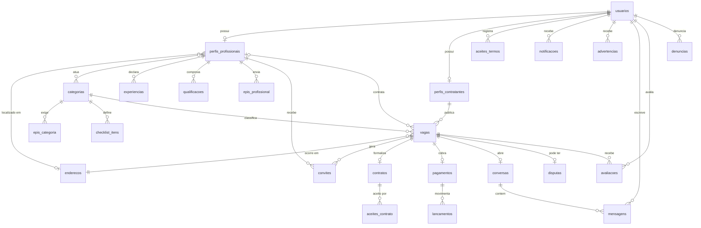

# Modelo de dados

Diagrama entidade-relacionamento das tabelas mantidas pelas migrações em `alembic/versions`.
Os modelos ficam em `app/models/` (`nucleo.py` e `contratacao.py`).

## Convenções

- Chaves primárias inteiras e nomes de tabela no plural, em português.
- Estados são enums armazenados como texto (compatível com PostgreSQL e SQLite).
- Valores monetários usam `Numeric(10, 2)`.
- Datas e horas são gravadas com fuso e obtidas por `app.tempo.agora()`, que pode ser
  substituído nos testes. O SQLite descarta o fuso ao ler; por isso as respostas da API passam
  por `app.tempo.como_utc()`.
- `lancamentos` é uma tabela de movimentações somente de inserção: o modelo recusa
  atualização e remoção, e a restrição `(pagamento_id, tipo)` impede um mesmo tipo de
  lançamento duas vezes. Correções entram como novos lançamentos. A imutabilidade vale no
  ORM; proteger contra SQL direto exigiria gatilho ou permissões no PostgreSQL.
- Restrições de domínio: nota de avaliação de 1 a 5, raio do profissional maior que zero,
  duração da vaga maior que zero, percentual de reembolso de 0 a 100 e mensagem com texto ou
  anexo.
- Tabelas auxiliares fora do diagrama acima: `configuracoes` (parâmetros por perfil de
  execução) e `categorias_profissional` (vínculo entre profissionais e categorias).
- Latitude e longitude ficam em colunas `float` na tabela `enderecos`; as distâncias são
  calculadas pela fórmula de Haversine, sem extensões geográficas do banco.
